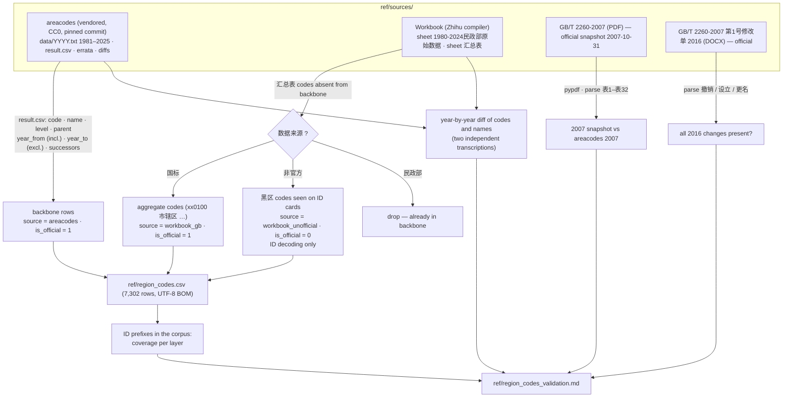
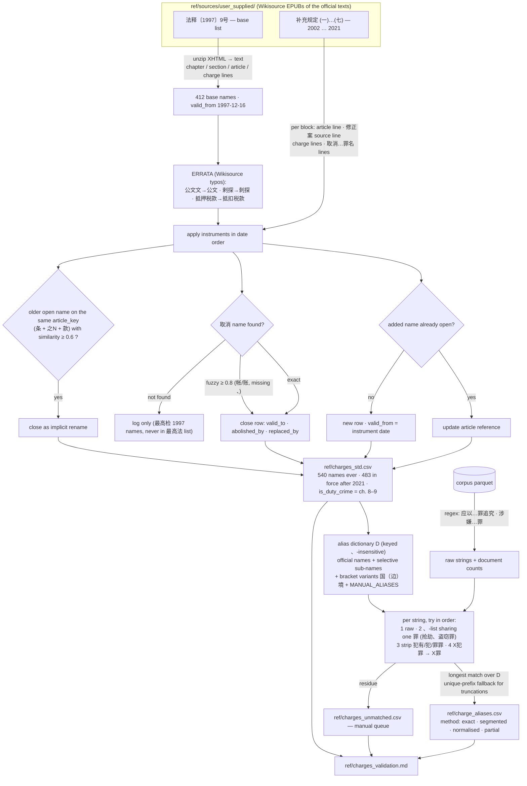

# Reference tables — build and cleaning logic

Two tables, two scripts, one rule: the published CSV is always regenerated from `ref/sources/` by
code, never edited by hand. Diagrams are Mermaid (rendered on GitHub; readable as text elsewhere).

## A. Region codes — `scripts/ref_regions.py` → `ref/region_codes.csv`

Rules worth remembering

- Validity windows come from areacodes unchanged; `year_to` is exclusive; a code can have several
  rows (name/parent change, or re-established after abolition).
- Pre-1995 differences between the two transcriptions are documented re-codings in
  `areacodes/errata.md` (county-level cities 1990–1994: xx90xx → xx81–99). Both forms stay reachable.
- 1980–1983 rows are not used for ID decoding (ID cards start in 1984; 民政部 back-filled those years).
- Nothing from the workbook's derived sheets (汇总表 successors, 代码变迁) enters the table except the
  two flagged extra layers above.

## B. Charges — `scripts/ref_charges.py` → `ref/charges_std.csv`, `ref/charge_aliases.csv`

Selective sub-names (how `贩卖毒品罪` finds `走私、贩卖、运输、制造毒品罪`)

1. Split the official name at 、; peel a leading modifier (非法 / 违法 / 擅自 …); read items as verbs
   while they are in the verb lexicon; the first verb+object item (储存枪支) marks where objects start.
2. Generate: every ordered subset of verbs (plus permutations for 2–3 verbs) × one object, where the
   shared head of the first object (国家机关 + 证件) or the shared tail of the last object (公司 + 印章)
   may be distributed, or several objects joined by 、; each item alone (非法控制计算机信息系统罪);
   all with and without the modifier.
3. Official names always win over generated forms when both exist (侮辱罪 stays 第246条).

Order of precedence inside the alias build: exact official name → generated/manual alias →
truncation with a unique prefix → wrapper removal. The 犯罪→罪 rewrite is tried last so that
掩饰、隐瞒犯罪 keeps its truncation match to 掩饰、隐瞒犯罪所得、犯罪所得收益罪.

## C. Conventions shared by both

- Outputs are UTF-8 with BOM so Excel opens them correctly; never save them back from Excel.
- Each script writes its own `*_validation.md`; the numbers in the data appendix come from there.
- Sources are never modified. Corrections live in code (`ERRATA`, `MANUAL_ALIASES`) and are listed in
  the validation reports.
